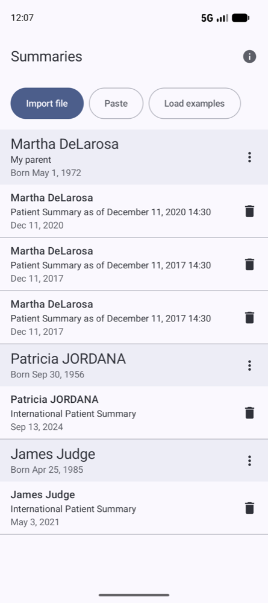
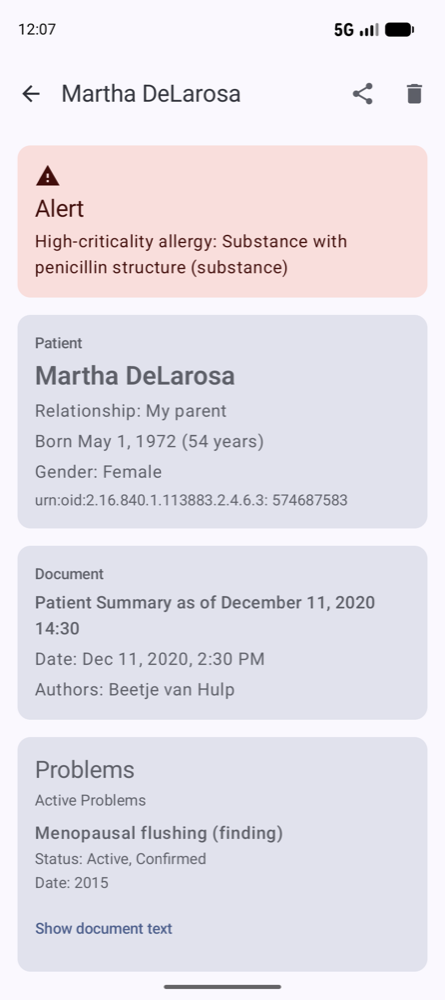
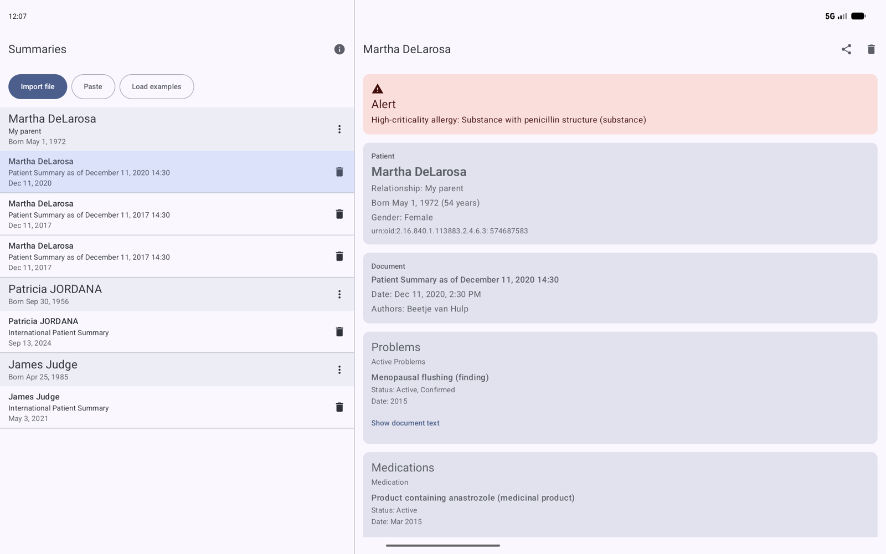

# International Patient Summary for Android

Open a person's International Patient Summary on your Android phone or
tablet and read it in seconds. An International Patient Summary (IPS) is a
short health record (allergies, medicines, problems, immunizations, results
and more) in the HL7 FHIR standard, meant to travel with a person across
borders and between care providers. This app opens one from a file or the
clipboard and shows what a clinician needs first, with high-criticality
allergies at the top. It speaks 66 languages. It has no account and no
internet permission. The summaries you open are saved on this phone only,
encrypted, so they are still there offline and after the phone restarts.
A summary leaves the phone only when you tap **Share**.

<p>
  
  
</p>
<p>
  
</p>

The screenshots, taken on Android 17 (API 37), show the five published,
fictional examples from the HL7 IPS Implementation Guide, which come with
the app.

> **Not a medical device.** The app shows what a document says and never
> changes its clinical content. Clinical decisions belong to the clinician
> reading the source record.

## Contents

- [Who it is for](#who-it-is-for)
- [Get started in one minute](#get-started-in-one-minute)
- [Open a summary](#open-a-summary)
- [Read a summary](#read-a-summary)
- [Share a summary](#share-a-summary)
- [Families and carers](#families-and-carers)
- [Privacy](#privacy)
- [Tablets, foldables and keyboards](#tablets-foldables-and-keyboards)
- [Languages and accessibility](#languages-and-accessibility)
- [When a document is refused](#when-a-document-is-refused)
- [Examples](#examples)
- [FAQ](#faq)
- [For developers](#for-developers)

## Who it is for

- **Patients and carers** who were given their summary as a file and want
  to see what it says, or show it to a doctor abroad.
- **Clinicians** who receive a summary and want its key facts quickly, in
  their own language, without signing in to anything.
- **Developers and testers** of IPS systems who want to check that a
  document opens and reads the way they expect.

## Get started in one minute

1. Open **Patient Summary** from your apps. The **Summaries** screen says
   no summaries are open.
2. Tap **Load examples**. Five example summaries appear, grouped under
   three people.
3. Tap the first **Martha DeLarosa**. Her penicillin allergy is in a red
   box at the top, in words, followed by her details, the document, and
   every section.
4. Close the app and open it again: the summaries are still there. Then
   tap **ⓘ** (About), and tap **Clear all**. The app is empty again, and
   the summaries are deleted from the phone.

## Open a summary

The three buttons at the top of the **Summaries** screen:

| Button            | What it does                                                                 |
| ----------------- | ---------------------------------------------------------------------------- |
| **Import file**   | Opens the system file picker. Choose a FHIR JSON file (`.json`). Files over 10 MB are refused before they are read. |
| **Paste**         | Opens the text you copied, for example from an email or a web page. The app reads the clipboard only when you tap this. |
| **Load examples** | Opens the five examples from the IPS Implementation Guide.                    |

### From another app

A JSON file you were sent opens straight from the app it is in:

- **Files**: tap the `.json` file and choose **Patient Summary**, or
  long-press it, tap **Share**, and choose **Patient Summary**.
- **Gmail** or another mail app: open the attachment, or tap **Share** on
  it, and choose **Patient Summary**.
- **Chrome**: open a downloaded `.json` from **Downloads**, or share it.
- **A messaging app**: **Share** the file to **Patient Summary**.

It opens exactly as if you had imported it: a file over 10 MB is refused
before it is read, the same checks apply, a refused file shows the same
alert and leaves the list as it was, and a summary that opens is saved like
any other. The app keeps no other copy of the file. The app is offered only
for JSON files, not for photos, links or other documents.

On a tablet, or with a mouse, you can also drag a JSON file, or text, from
another app onto the list. See
[Tablets, foldables and keyboards](#tablets-foldables-and-keyboards).

Every document is checked before it opens (see
[When a document is refused](#when-a-document-is-refused)). The list is
grouped by person, and the newest summary is at the top. See
[Families and carers](#families-and-carers). To remove one, swipe its row away or tap
its delete button. An open summary also has a delete button at the top.

## Read a summary

A summary always reads in the same order:

1. **Alert.** Allergies with high criticality, in a red box, in words, so
   they don't depend on colour. If the document has no allergies section at
   all, the box says so.
2. **Patient.** Name, birth date and age, gender, and identifiers with the
   system that issued them (for example, an NHS number or a New Zealand
   NHI).
3. **Document.** Its title, date and authors.
4. **Sections.** In the order the document gives them, for example
   Problems, Medications, Allergies and intolerances, Immunizations,
   Results and Procedures. A known section is headed with the app's own
   name for it, in your language. The document's own title, when it is
   different, is shown beneath.

Each entry is one card: the condition, medicine, vaccine or result, with
its details beneath (status, criticality and reactions, dosage, dates,
values and units). Codes such as "active" or "confirmed" are written in
your language. Clinical text from the document (names of conditions and
medicines, notes) is shown exactly as written and never translated.

### When information is missing

The IPS standard asks every summary to say something about allergies,
medicines and problems, even when there is nothing to report. The app
spells out what the document says:

| You see                            | It means                                                      |
| ---------------------------------- | ------------------------------------------------------------- |
| **None known**                     | The author checked and found none, for example "no known allergies". |
| **Not recorded**                   | Nobody asked, or the section is empty.                        |
| **Information unavailable**        | The information exists but was withheld or can't be given.    |
| **Section missing from document**  | A required section is absent from the document altogether.    |

### The document's own text

Most sections also carry the author's narrative, a human-readable version of
the section. Tap **Show document text** to read it as plain text. Nothing in
it is run or loaded, and it contains no links or images.

## Share a summary

Tap **Share** on an open summary and choose one of two things, then send
it with Quick Share, Gmail, Messages, Files or any other app on the share
sheet:

- **Share the file (FHIR JSON)** sends the **exact file the summary was
  opened from**, unchanged, typed `application/fhir+json`, for another app
  or a clinician's system. It is always named
  `international-patient-summary.json`.
- **Share as PDF** sends a **one-page summary for people**: to hand to a
  clinician, print, or keep with travel papers. It is named after the
  document's date, such as `international-patient-summary-2024-09-13.pdf`.

Neither file is ever named after the patient, so the name gives nothing
away in a download folder or a message preview. The temporary copy made for
sharing is deleted when the share sheet returns, and again at the next
launch; the app keeps no copy. When summaries of more than one person are
open, the app first asks **Share the summary of** and the name, so you
don't send the wrong person's record. Nothing is sent until you tap
**Share**.

### What the PDF contains

- At the top, the patient's name, birth date and age, gender and first
  identifier.
- A box with a red border, **Alerts and allergies**: the document's alerts,
  then every allergy and intolerance with its criticality and reactions (or,
  when the document has no allergies section, a line saying so).
- Then the sections, most important first: medications, problems,
  immunizations, results, procedures, devices, advance directives, vital
  signs, past illnesses, plan of care, social history, functional status,
  pregnancy, patient story, then any other section. Each entry is one line:
  its name in bold, then its details (status, dosage, date, value)
  separated by " · ". A missing or empty section says so, as on screen.
- At the bottom of every page: when the PDF was made, the date of the
  source document, "IPS 2.0.1 (HL7 FHIR R4)", a reminder that the app is
  not a medical device, and "Page 1 of 1".

The app's words are in your language; the clinical text is as the
document wrote it. The paper is US Letter when the app's language is
English (United States), A4 otherwise. In Arabic, Hebrew, Persian and Urdu
the page reads from right to left.

### How it fits on one page

The app lays the page out and, until it fits on one page:

1. makes the text smaller, from 10 down to 8 points;
2. then shows only the 3 most recent entries of the least important
   sections, and then only 1, with a line "More not shown" and how many;
3. then leaves out whole sections, least important first, with "Section
   present — not shown on this one-page summary".

Every shortened or left-out section is named on a "Not shown on this page"
line, so the reader knows to look at the full record. The patient's
identity, alerts, allergies and current medicines are never cut. If they
alone do not fit on one page, the PDF runs on to further pages, and every
page says **CONTINUED — this summary exceeds one page**. All five examples fit on one
page as they are.

## Families and carers

You may read summaries for several people: your children, your parents,
or someone you care for. The app keeps each person's summaries together.

- **Grouped by person.** The **Summaries** list has a heading for each
  person, with their name and birth date, and their summaries beneath it,
  newest first. Two summaries belong to the same person when they share an
  identifier (the same system and number), or when the name and birth date
  are the same. Case, accents and spacing in the name don't matter.
- **Relationship.** Tap **⋮** beside a person's name and choose who they
  are to you: **Me**, **My partner**, **My parent**, **My child**, **My
  sibling**, **My grandparent**, **My grandchild**, **Other family** or
  **Someone I care for**. It shows under their name and in the banner of
  each of their summaries. Only one person can be **Me**.
- **Forget this person.** The same menu forgets every summary about that
  person, after asking you to confirm.
- **Only a note.** The relationship is the app's note, not part of any
  document. It is never shared. Like the summaries, it is saved on this
  phone only, encrypted, and kept after the phone restarts. It is gone when
  the person's last summary is gone, or after **Clear all**.

## Privacy

This app is built so that it has nothing to leak.

- **Saved on this phone only, encrypted.** Summaries, and the
  relationships you give people, are saved on this phone, so they are
  there after you close the app and after the phone restarts. Each one is
  encrypted with a key that never leaves the phone (Android's Keystore).
  Nothing else on the phone, and nothing outside it, holds them.
- **Checked again.** Each time the app starts, it checks every saved
  summary again. One that cannot be read is deleted.
- **No network.** The app doesn't ask for the internet permission, so
  Android won't let it connect anywhere. A test checks this on every build.
  There is no account, no analytics and no crash reporting.
- **No backup.** Android backup and device-to-device transfer are turned
  off for the app. A new phone starts empty.
- **Only when you share.** A summary leaves the device only when you tap
  **Share** and choose where it goes.
- **Covered in Recents.** When you leave the app, it covers its window, so
  the Recents screen shows no patient data. Screenshots are still allowed,
  so you can show a summary to a clinician.
- **Deleting deletes.** **Delete**, **Forget this person** and
  **About → Clear all** delete those summaries from the phone at once,
  after asking you to confirm where they ask. **Clear all** also deletes
  the key, so nothing left can be read.
- **No logs.** The app never logs document content, names or identifiers.

## Tablets, foldables and keyboards

In a window 840 dp wide or more (most tablets in landscape, an unfolded
foldable, or a desktop window), the list stays on the left and the open
summary fills the rest of the screen, so you can move between summaries
without going back. The open summary's row is highlighted. In a narrower
window, the app works as it does on a phone. Folding or unfolding keeps every open summary,
every relationship and the summary you are reading.

**Keyboard shortcuts** with a hardware keyboard (press Meta + / to list
them):

| Keys            | Action                     |
| --------------- | -------------------------- |
| Ctrl O          | Import file                |
| Ctrl V          | Paste                      |
| Ctrl E          | Load examples              |
| Ctrl Backspace  | Delete the open summary    |

**Drag and drop:** drag a JSON file from a file manager, or a selection of
text, onto the list. It opens exactly as if imported or pasted, with the
same checks and the same 10 MB limit. The app keeps no copy of the dropped
file.

## Languages and accessibility

The app follows your device's language. It speaks English plus 65
localizations: 60 languages, Brazilian and European Portuguese, Simplified
and Traditional Chinese, and British English. Arabic, Hebrew, Persian and
Urdu lay out right to left. Dates and ages use your language's own digits.
On Android 13 and later you can give the app its own language in
**Settings → Apps → Patient Summary → Language**.

The translations were machine-made and are waiting for review by clinicians
who read each language. Treat any wording that seems wrong with care, and
please report it (see the [FAQ](#faq)).

The app works with TalkBack: section titles are headings, and each card
reads as one sentence. Text follows your font size up to the largest
sizes, touch targets are at least 48 dp, and the app follows light and dark
theme.

## When a document is refused

The app opens only an IPS document. It checks each one in this order, and
the first failure is shown in an alert with its code. The list does not
change, and the alert never quotes the document.

| Code                    | Reason                                                         |
| ----------------------- | -------------------------------------------------------------- |
| `too_large`             | The file is larger than 10 MB.                                 |
| `not_json`              | The text is not JSON (for example XML, YAML or a PDF).          |
| `not_a_bundle`          | The JSON is not a FHIR Bundle.                                 |
| `not_a_document`        | The Bundle's `type` is not `document`.                         |
| `no_composition`        | The Bundle's first entry is not a Composition.                 |
| `not_a_patient_summary` | The Composition's type is not LOINC `60591-5` (Patient summary). |
| `no_subject`            | The Composition does not name its patient.                     |

These are the same checks, in the same order with the same codes, as this
repository's web viewer, service and iOS app. A document that one accepts,
the others accept too.

## Examples

**The smallest document the app opens.** Save this as `example.json` and
import it, or copy it and tap **Paste**. It opens as a summary for "Example
Patient", with the three required sections marked **Section missing from
document**.

```json
{
  "resourceType": "Bundle",
  "type": "document",
  "entry": [
    {
      "fullUrl": "urn:uuid:composition-1",
      "resource": {
        "resourceType": "Composition",
        "status": "final",
        "type": { "coding": [{ "system": "http://loinc.org", "code": "60591-5" }] },
        "subject": { "reference": "urn:uuid:patient-1" },
        "date": "2026-01-15",
        "title": "Patient summary"
      }
    },
    {
      "fullUrl": "urn:uuid:patient-1",
      "resource": {
        "resourceType": "Patient",
        "name": [{ "given": ["Example"], "family": "Patient" }],
        "birthDate": "1980-04-01"
      }
    }
  ]
}
```

**A refusal.** Change `"type": "document"` to `"type": "collection"` and
open it again. The app refuses it with code `not_a_document`.

**The five built-in examples**, from the HL7 IPS Implementation Guide:

| Patient                         | What it shows                                                        |
| ------------------------------- | -------------------------------------------------------------------- |
| Martha DeLarosa, Dec 11, 2020   | A short summary: a high-criticality penicillin allergy, a problem and a medicine |
| Patricia Jordana, Sep 13, 2024  | Every IPS section: required, recommended and optional                |
| James Judge, May 3, 2021        | Required sections whose information was withheld: "Information unavailable" |
| Martha DeLarosa, Dec 11, 2017   | The IG's Bundle-01: problems, medicines, allergies, past problems, plan of treatment, results |
| Martha DeLarosa, Dec 11, 2017   | The same, with immunizations                                         |

## FAQ

**Where are my summaries stored?**
On this phone only, encrypted, inside the app's own storage. They are not
in backups and not in the cloud. They stay until you delete them, or use
**Clear all**.

**Will my summaries still be there after I restart my phone?**
Yes. They are there after you close the app, after Android ends it, and
after the phone restarts. The app opens to the list. If you clear the
app's storage in Settings, or move to a new phone, the app starts empty:
open the files again.

**Can I keep summaries for my family?**
Yes. Open each person's summaries and the list groups them by person.
Give each person a relationship, such as **My child** or **My parent**,
from **⋮** beside their name. Like the summaries, the relationships are
saved on this phone only, encrypted, and never shared. **Forget this
person** or **Clear all** deletes them.

**Can I use the app without internet?**
Yes. The app has no internet permission, so it works the same in airplane
mode. Your saved summaries are on the phone, so they are there offline
too.

**Does anyone else see the summaries I open?**
No. Nothing is sent anywhere unless you tap Share and choose a recipient.
There is no account and no server.

**Why does Android show "pasted from your clipboard"?**
Android tells you whenever an app reads the clipboard. This app reads it
only when you tap **Paste**.

**Can I print it?**
Yes. Tap **Share**, then **Share as PDF**, and send it to an app that can
print, such as Drive, or save it to Files and print it from there (the
apps on the share sheet depend on your phone). The PDF is one page, sized
for A4, or US Letter when the app is in English (United States). The app
has no print button of its own and keeps no copy.

**Can I edit a summary, or write my own?**
Not yet. The app shows a summary exactly as written. Writing your own
summary, and SMART Health Links and QR codes, are on the
[roadmap](plans.md).

**Why isn't Patient Summary offered when I tap a file?**
The app is offered only for files that say they are JSON
(`application/json` or `application/fhir+json`). Some apps label a `.json`
file as a plain or unknown file; save it to Files, or use **Import file**
in the app, and choose it there.

**Can it open XML, a PDF, or a QR code?**
Not yet. It opens FHIR R4 JSON only. A PDF or XML file is refused as
`not_json`. (It can make a PDF: see [Share a summary](#share-a-summary).)

**My document was refused. What now?**
Read the code in the alert and look it up in
[When a document is refused](#when-a-document-is-refused). Most often, the
file is a FHIR Bundle of another kind (`not_a_document`), or a summary of
another type (`not_a_patient_summary`). Ask whoever made the file for an
International Patient Summary.

**Why is a section heading different from the document's title?**
The app names each known section in your language. The document's own
title, in its own language, is shown beneath the heading when it differs.

**My tablet shows one screen at a time. Why?**
The list sits beside the summary only when the window is at least 840 dp
wide. Most tablets reach that in landscape; in portrait, many don't.

**Is the app a medical device?**
No. It shows what a document says and never changes its clinical content.
Always check important decisions against the source record.

**A translation looks wrong. How do I report it?**
Open an issue in this repository's issue tracker, naming the language, the
screen, and the words you'd expect. The translations live in
[`international-patient-summary-app-translations`](../international-patient-summary-app-translations/).

**Is there an iPhone version?**
Yes:
[`international-patient-summary-app-with-swift`](../international-patient-summary-app-with-swift/),
for iPhone and iPad, with the same screens, checks and privacy rules.

**What does it need?**
Android 10 (API 29) or later, on a phone, tablet or foldable.

## For developers

The app is Kotlin only (no Java source files), with Jetpack Compose and
Material 3. The specification is [spec/index.md](spec/index.md), one file
per section. [plans.md](plans.md) and [tasks.md](tasks.md) say what is
built and what comes next. [AGENTS.md](AGENTS.md) has the rules for
changing it.

### Build and test

Needs JDK 21 or later and the Android SDK (platform 37; Gradle installs it
if missing). Point Gradle at the SDK with a `local.properties` (gitignored):

```properties
sdk.dir=/path/to/Android/sdk
```

```sh
# the core, on the JVM, no emulator
./gradlew :app:testDebugUnitTest

# build, and lint with warnings as errors
./gradlew :app:assembleDebug :app:lintDebug

# install on a running emulator or a phone
./gradlew :app:installDebug

# the smoke test on a running emulator or a phone (Compose UI Test):
# load the examples, open one, Clear all. It empties the app's saved summaries.
./gradlew :app:connectedDebugAndroidTest
```

The first three must pass before a change is finished; run the smoke test
too when a screen changes. The manual checks are in
[spec/verification.md](spec/verification.md).

### Layout

```text
app/src/main/kotlin/io/github/internationalpatientsummary/app/
  ips/        the core: check, references, sections, absent data, formatting, people, the PDF's rules (no android.*)
  ui/         Compose screens: Summaries, Summary, About; the two-pane layout
  MainActivity.kt, AppViewModel.kt, SummaryStore.kt, ShareFiles.kt, Shortcuts.kt, Drops.kt
  OnePagePdf.kt   the one-page PDF, drawn with PdfDocument
  EncryptedStore.kt, KeystoreKeys.kt   the encrypted store and its Keystore key
app/src/main/assets/examples/   the five IG examples
app/src/main/res/values/strings.xml   every interface string (English)
app/src/main/res/values-*/            the same strings in 65 languages (generated)
app/src/test/                  JVM unit tests and fixtures
app/src/androidTest/           the Compose smoke test and the PDF test, on an emulator
gradle/libs.versions.toml      every version, each at least two days old when adopted
screenshots/                   the pictures in this README, from the Pixel 10 emulator (API 37)
spec/                          the specification, one file per section
```

### Translations

English interface strings are in `app/src/main/res/values/strings.xml`.
Every other language is written in by the script in
[`international-patient-summary-app-translations`](../international-patient-summary-app-translations/),
which serves both mobile apps. Change English here, then follow that
folder's README.

## License

See [LICENSE.md](LICENSE.md).
