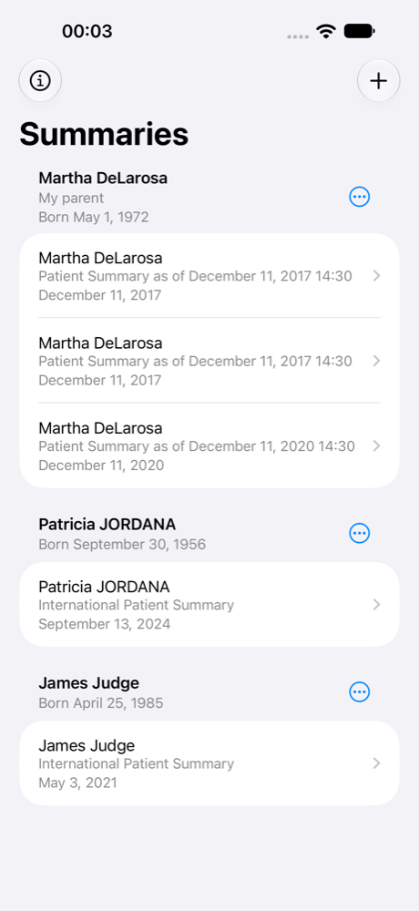
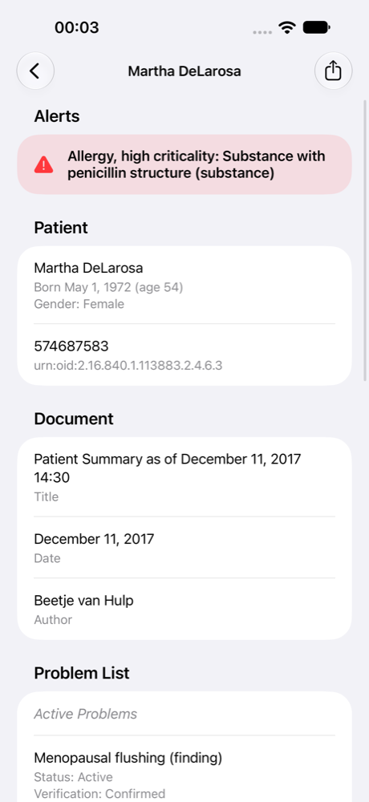
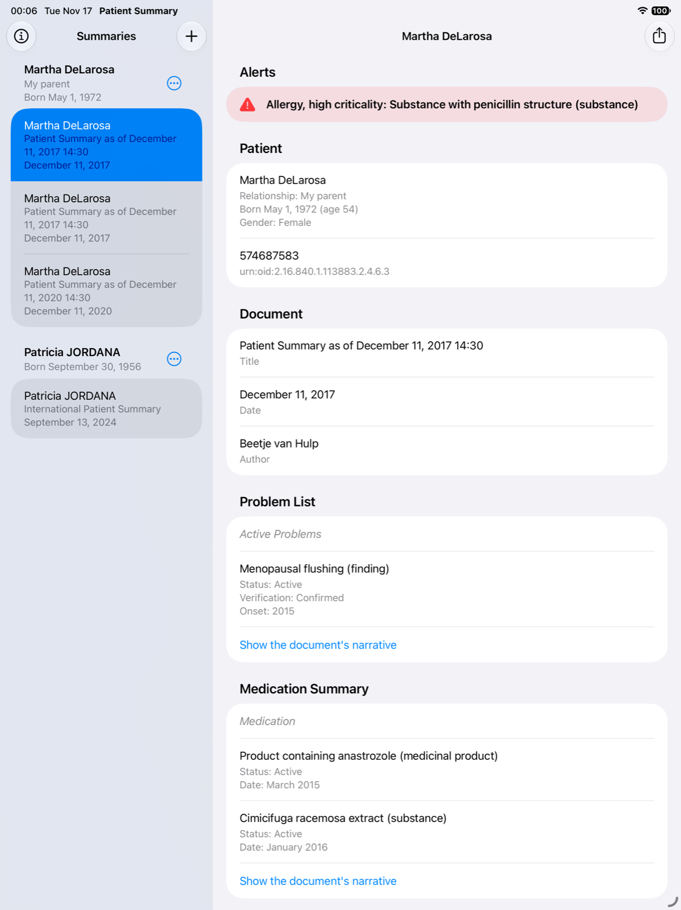

# International Patient Summary for iPhone and iPad

Open a person's International Patient Summary on your iPhone or iPad and
read it in seconds. An International Patient Summary (IPS) is a short
health record (allergies, medicines, problems, immunizations, results and
more) in the HL7 FHIR standard, meant to travel with a person across
borders and between care providers. This app opens one from a file or the
clipboard and shows what a clinician needs first, with high-criticality
allergies at the top. It speaks 66 languages. It works offline and keeps
your summaries after a restart: they are saved on the device only,
encrypted, until you delete them. It has no account and no internet access,
and a summary leaves the device only when you tap **Share**.

<p>
  
  
</p>
<p>
  
</p>

The screenshots, taken on iOS 27.2, show the five published, fictional
examples from the HL7 IPS Implementation Guide, which come with the app.

> **Not a medical device.** The app shows what a document says and never
> changes it. Clinical decisions belong to the clinician reading the source
> record.

## Contents

- [Who it is for](#who-it-is-for)
- [Get started in one minute](#get-started-in-one-minute)
- [Open a summary](#open-a-summary)
- [Read a summary](#read-a-summary)
- [Share a summary](#share-a-summary)
- [Families and carers](#families-and-carers)
- [Privacy](#privacy)
- [iPad and iPhone Duo](#ipad-and-iphone-duo)
- [Languages and accessibility](#languages-and-accessibility)
- [When a document is refused](#when-a-document-is-refused)
- [Examples](#examples)
- [FAQ](#faq)
- [For developers](#for-developers)

## Who it is for

- **Patients and carers** who were given their summary as a file and want
  to see what it says, or show it to a doctor abroad.
- **Clinicians** who receive a summary and want its key facts quickly, in
  their own language, without signing in to anything.
- **Developers and testers** of IPS systems who want to check that a
  document opens and reads the way they expect.

## Get started in one minute

1. Open **Patient Summary** on your home screen. The **Summaries** screen says no summaries are open.
2. Tap **Load examples**. Five example summaries appear.
3. Tap **Martha DeLarosa**. Her penicillin allergy is in a red box at the
   top, in words, followed by her details, the document, and every section.
4. Tap **ⓘ** (About), scroll down, and tap **Clear all summaries**. The app
   is empty again.

## Open a summary

There are three ways. On the empty screen each has its own button; once a
summary is open, they are under **+**.

| Way               | What it does                                                                 |
| ----------------- | ---------------------------------------------------------------------------- |
| **Import file**   | Opens Files. Choose a FHIR JSON file (`.json`). Files over 10 MB are refused before they are read. |
| **Paste**         | Opens the text you copied, for example from an email or a web page. iOS asks you to allow the paste. |
| **Load examples** | Opens the five examples from the IPS Implementation Guide.                    |

**From another app:** in Files, Mail, Safari or a messaging app, open a
`.json` file's share menu and choose **Patient Summary** (or **Open in**).
It opens as if imported, with the same checks.

On iPad you can also drag a JSON file, or copied text, from another app
onto the list. See [iPad](#ipad).

Every document is checked before it opens (see
[When a document is refused](#when-a-document-is-refused)). The newest
summary is at the top of the list. To remove one, swipe its row left and
tap **Delete**. With VoiceOver, use the row's **Delete** action.

## Read a summary

A summary always reads in the same order:

1. **Alerts.** Allergies with high criticality, in a red box, in words, so
   they don't depend on colour. If the document has no allergies section at
   all, the box says so.
2. **Patient.** Name, birth date and age, gender, and identifiers with the
   system that issued them (for example, an NHS number or a New Zealand
   NHI).
3. **Document.** Its title, date and authors.
4. **Sections.** In the order the document gives them, for example Problem
   List, Medication Summary, Allergies and Intolerances, Immunizations,
   Results and Procedures. A known section is headed with the app's own
   name for it, in your language. The document's own title, when it is
   different, is shown beneath.

Each entry is one row: the condition, medicine, vaccine or result, with its
details beneath (status, criticality and reactions, dosage, dates, values
and units). Codes such as "active" or "confirmed" are written in your
language. Clinical text from the document (names of conditions and
medicines, notes) is shown exactly as written and never translated.
Numeric clinical values keep the exact JSON token, including trailing zeroes
and high precision. Partial dates stay partial; an invalid date is shown as
its source text and never produces an age.

### When information is missing

The IPS standard asks every summary to say something about allergies,
medicines and problems, even when there is nothing to report. The app
spells out what the document says:

| You see                            | It means                                                      |
| ---------------------------------- | ------------------------------------------------------------- |
| **None known**                     | The author checked and found none, for example "no known allergies". |
| **Not recorded**                   | Nobody asked, or the section is empty.                        |
| **Information unavailable**        | The information exists but was withheld or can't be given.    |
| **Section missing from document**  | A required section is absent from the document altogether.    |

### The document's own text

Most sections also carry the author's narrative, a human-readable version of
the section. Tap **Show the document's narrative** to read it as plain
text. Nothing in it is run or loaded, and it contains no links or images.

## Share a summary

Tap **Share** (the square with an arrow) on an open summary and choose:

- **Share the file (FHIR JSON)**: the **exact file the summary was opened
  from**, unchanged, for another app or a clinician's system. It is always
  named `international-patient-summary.json`, never after the patient.
- **Share as PDF**: a one-page summary for people, to print or hand over.
  It starts with the patient, then a red box of alerts and allergies, then
  the sections in clinical order: medicines, problems, immunizations,
  results, procedures, devices, advance directives, and the rest. To fit
  one page it uses a smaller font, then shows only the most recent entries
  of the least urgent sections ("More not shown: 3"), and says at the
  bottom what it left out. The patient, alerts, allergies and current
  medicines are never left out; if they need more than a page, both pages
  say "CONTINUED". It is US Letter in US English, A4 otherwise, and is
  named by the document's date, such as
  `international-patient-summary-2024-09-13.pdf`.

Then send it with AirDrop, Mail, Messages, Files, a printer, or any other
app on the share sheet. With summaries of more than one person open, the
app first asks whose summary you're sending. Each Share tap has its own
temporary directory, so one share cannot replace or delete another
recipient's file. Its copy is deleted when that share finishes or is
cancelled; abandoned copies are deleted at the next launch.

## Families and carers

Many people look after someone else's health as well as their own: a
parent for their children, an adult for their parents, a carer for the
people they support. The app helps you keep their summaries apart.

- **Grouped by person.** The Summaries list has a heading for each person,
  with their summaries beneath, newest first. Two summaries are the same
  person when they share an identifier (such as an NHS number), or the same
  name and birth date.
- **Relationships.** Tap **⋯** beside a person's name, then
  **Relationship**, to say who they are to you: Me, My partner, My parent,
  My child, My sibling, My grandparent, My grandchild, Other family, or
  Someone I care for. It shows in their heading and at the top of each of
  their summaries. Only one person can be Me.
- **Share the right one.** When summaries of more than one person are open,
  **Share** first asks "Share the summary of …?" with the patient's name,
  so you don't send your mother's record when you meant your son's.
- **Forget one person.** Tap **⋯**, then **Forget this person**, to remove
  all their summaries at once.

A relationship is the app's note, not part of the document. It's saved
with the summaries, never shared, and deleted with them.

## Privacy

This app is built so that it has nothing to leak.

- **On this device only, encrypted.** Every summary you open, and every
  relationship, is saved at once in the app's encrypted store, so it is
  still there after you close the app or restart the device, and with no
  network. Each file is encrypted (AES-256-GCM) with a key kept in the
  Keychain for this device only, which can be read only while the device is
  unlocked. iOS's file protection is on too.
- **A failed save is visible and retryable.** The summaries stay open in
  memory, and the app says they are not saved. **Try again** writes the full
  set. If the key or a file is only temporarily unavailable, the encrypted
  store is left unchanged until it can be read and merged safely.
- **Not in backups.** The store is left out of iCloud and computer backups,
  and the key never leaves the device, so a new or restored device starts
  empty.
- **No network.** The app contains no networking code and makes no
  requests. There is no account, no analytics and no crash reporting. Its
  privacy manifest declares no tracking and no data collected.
- **Only when you share.** A summary leaves the device only when you tap
  **Share** and choose where it goes.
- **Covered in the app switcher.** When you leave the app, a plain cover
  with the app's name hides the summary, so the app switcher shows no
  patient data.
- **Deleting deletes.** **Delete** and **Forget this person** delete those
  summaries' files at once. **About → Clear all summaries** deletes every
  summary and relationship, and the key, after asking you to confirm.
- **No logs.** The app never logs document content, names or identifiers.

## iPad and iPhone Duo

On iPad, on an unfolded iPhone Duo, and in any window wide enough, the
list stays on the left and the open summary fills the rest of the screen,
so you can move between summaries without going back. In a narrow window,
such as a small Split View or Slide Over, or on a folded iPhone Duo, the
app works as it does on any iPhone. Folding or unfolding a Duo keeps your
summaries, your relationships and the summary you're reading.

**Keyboard shortcuts** with a hardware keyboard (hold ⌘ to see them):

| Keys  | Action                     |
| ----- | -------------------------- |
| ⌘ O   | Import file                |
| ⌘ V   | Paste                      |
| ⌘ E   | Load examples              |
| ⌘ ⌫   | Delete the open summary    |

**Drag and drop:** drag a JSON file from Files, or a selection of text,
onto the list. It opens exactly as if imported or pasted, with the same
checks and the same 10 MB limit. The app keeps no copy of the dropped file.

## Languages and accessibility

The app follows your iPhone or iPad language. It speaks English plus 65
localizations: 60 languages, Brazilian and European Portuguese, Simplified
and Traditional Chinese, and British English. Arabic, Hebrew, Persian and
Urdu lay out right to left. Dates and ages use your language's own digits.
To use the app in a language other than the device's, go to **Settings →
Apps → Patient Summary → Language**.

The translations were machine-made and are waiting for review by clinicians
who read each language. Treat any wording that seems wrong with care, and
please report it (see the [FAQ](#faq)).

The app works with VoiceOver: section titles are headings, and each row
reads as one sentence. Text follows your text size up to the largest
accessibility sizes, and the app follows light and dark appearance.

## When a document is refused

The app opens only an IPS document. It checks each one in this order, and
the first failure is shown in an alert with its code. The list does not
change, and the alert never quotes the document.

| Code                    | Reason                                                         |
| ----------------------- | -------------------------------------------------------------- |
| `too_large`             | The file is larger than 10 MB.                                 |
| `not_json`              | The text is not JSON (for example XML, YAML or a PDF).          |
| `not_a_bundle`          | The JSON is not a FHIR Bundle.                                 |
| `not_a_document`        | The Bundle's `type` is not `document`.                         |
| `no_composition`        | The Bundle's first entry is not a Composition.                 |
| `not_a_patient_summary` | The Composition's type is not LOINC `60591-5` (Patient summary). |
| `no_subject`            | The Composition does not name its patient.                     |

These are the same checks, in the same order with the same codes, as this
repository's web viewer and service. A document that one accepts, the
others accept too.

## Examples

**The smallest document the app opens.** Save this as `example.json` and
import it, or copy it and tap **Paste**. It opens as a summary for "Example
Patient", with the three required sections marked **Section missing from
document**.

```json
{
  "resourceType": "Bundle",
  "type": "document",
  "entry": [
    {
      "fullUrl": "urn:uuid:composition-1",
      "resource": {
        "resourceType": "Composition",
        "status": "final",
        "type": { "coding": [{ "system": "http://loinc.org", "code": "60591-5" }] },
        "subject": { "reference": "urn:uuid:patient-1" },
        "date": "2026-01-15",
        "title": "Patient summary"
      }
    },
    {
      "fullUrl": "urn:uuid:patient-1",
      "resource": {
        "resourceType": "Patient",
        "name": [{ "given": ["Example"], "family": "Patient" }],
        "birthDate": "1980-04-01"
      }
    }
  ]
}
```

**A refusal.** Change `"type": "document"` to `"type": "collection"` and
open it again. The app refuses it with code `not_a_document`.

**The five built-in examples**, from the HL7 IPS Implementation Guide:

| Patient                         | What it shows                                                        |
| ------------------------------- | -------------------------------------------------------------------- |
| Martha DeLarosa, Dec 11, 2020   | A short summary: a high-criticality penicillin allergy, a problem and a medicine |
| Patricia Jordana, Sep 13, 2024  | Every IPS section: required, recommended and optional                |
| James Judge, May 3, 2021        | Required sections whose information was withheld: "Information unavailable" |
| Martha DeLarosa, Dec 11, 2017   | The IG's Bundle-01: problems, medicines, allergies, past problems, plan of treatment, results |
| Martha DeLarosa, Dec 11, 2017   | The same, with immunizations                                         |

## FAQ

**Where are my summaries stored?**
On this device only, in the app's own storage, encrypted. They stay until
you delete them, or delete the app.

**Will my summaries still be there after I restart?**
Yes. Close the app, restart the device, turn on flight mode: when you open
the app, your summaries and relationships are there, newest first.

**Will they move to my new phone?**
No. The store is kept out of backups and its key never leaves this device,
so a new or restored device starts empty. Keep the original files (or
share them to yourself) to open them on another device.

**Can I use the app without internet?**
Yes. The app never uses the internet, so it works the same in flight mode.

**Does anyone else see the summaries I open?**
No. Nothing is sent anywhere unless you tap Share and choose a recipient.
There is no account and no server.

**Can I edit a summary, or write my own?**
Not yet. The app shows a summary exactly as written. Writing your own
summary, SMART Health Links and QR codes, and PDF export are on the
[roadmap](plans.md).

**Can I print a summary?**
Yes: **Share → Share as PDF**, then **Print** on the share sheet.

**Can it open XML, a PDF, or a QR code?**
Not yet. It opens FHIR R4 JSON only. A PDF or XML file is refused as
`not_json`.

**My document was refused. What now?**
Read the code in the alert and look it up in
[When a document is refused](#when-a-document-is-refused). Most often, the
file is a FHIR Bundle of another kind (`not_a_document`), or a summary of
another type (`not_a_patient_summary`). Ask whoever made the file for an
International Patient Summary.

**Why is a section heading different from the document's title?**
The app names each known section in your language. The document's own
title, in its own language, is shown beneath the heading when it differs.

**Can I keep summaries for my whole family?**
Yes. Open each person's summary and the list groups them by person; give
each a relationship so you can tell them apart at a glance. See
[Families and carers](#families-and-carers). Like every summary, they are
saved on this device, encrypted, until you delete them.

**I care for several people. How do I avoid sharing the wrong summary?**
With more than one person open, Share always asks you to confirm whose
summary you're sending, by name. Forget a person when you've finished with
their summary.

**Is the app a medical device?**
No. It shows what a document says and never changes its clinical content.
Always check important decisions against the source record.

**A translation looks wrong. How do I report it?**
Open an issue in this repository's issue tracker, naming the language, the
screen, and the words you'd expect. The translations live in
[`international-patient-summary-app-translations`](../international-patient-summary-app-translations/).

**Is there an Android version?**
Yes:
[`international-patient-summary-app-with-kotlin`](../international-patient-summary-app-with-kotlin/),
with the same screens, checks and privacy rules.

**What does it need?**
iOS 18 or later on iPhone or iPad. The iPhone Duo needs iOS 27.1 or later.

## For developers

The app is Swift 6 and UIKit, built entirely in code: no SwiftUI, no
storyboards and no dependencies outside Apple's SDKs. The specification is
[spec/index.md](spec/index.md), one file per section. [plans.md](plans.md)
and [tasks.md](tasks.md) say what is built and what comes next.
[AGENTS.md](AGENTS.md) has the rules for changing it.

### Build and test

Requires Xcode 27.2 or later (Swift 6.4).

```sh
# the core, on the Mac, no simulator
cd IPSKit && swift test && cd ..

# the app, end to end, on the newest iPhone (the paste test takes about three minutes)
xcodebuild test -project IPSApp.xcodeproj -scheme IPSApp \
  -destination 'platform=iOS Simulator,name=iPhone 18 Pro Max' CODE_SIGN_IDENTITY=- CODE_SIGNING_REQUIRED=NO

# the side-by-side tests, on an iPad
xcodebuild test -project IPSApp.xcodeproj -scheme IPSApp \
  -destination 'platform=iOS Simulator,name=iPad Air 13-inch (M4)' CODE_SIGN_IDENTITY=- CODE_SIGNING_REQUIRED=NO

# or open in Xcode and run the IPSApp scheme
open IPSApp.xcodeproj
```

The UI tests sign the app ad hoc (`CODE_SIGN_IDENTITY=-`, no team needed):
the encrypted store's key is a Keychain item, and an unsigned app cannot
keep one. The manual checks are in [spec/verification.md](spec/verification.md).

### Layout

```text
IPSKit/        Swift package with no UIKit: check, document reader, formatting, tests
App/           the UIKit app (Xcode synchronized folder: add files, no project edits)
UITests/       XCUITest end-to-end tests
screenshots/   the pictures in this README: the newest runtime and iPhone (spec §8.4)
spec/          the specification, one file per section; index.md is the contents
plans.md       phases; tasks.md the checklist
```

### Translations

Interface strings are in `App/Localizable.xcstrings`. Every language other
than US English is written in by the script in
[`international-patient-summary-app-translations`](../international-patient-summary-app-translations/),
which serves both mobile apps. Change English here, then follow that
folder's README.

### Ideas from MyIPS

The [MyIPS user guide](https://myips.health/user-guide/) shaped this app's
privacy model and its roadmap. Spec §1.1 lists what was taken now and what
waits.

## License

See [LICENSE.md](LICENSE.md).
